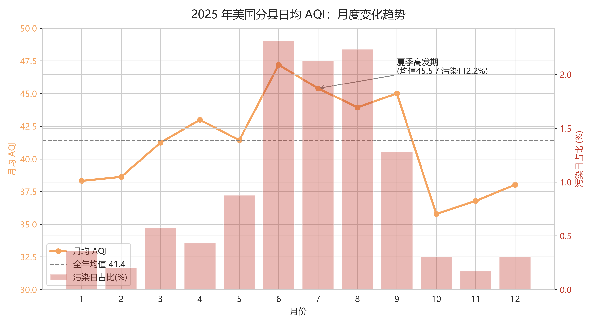
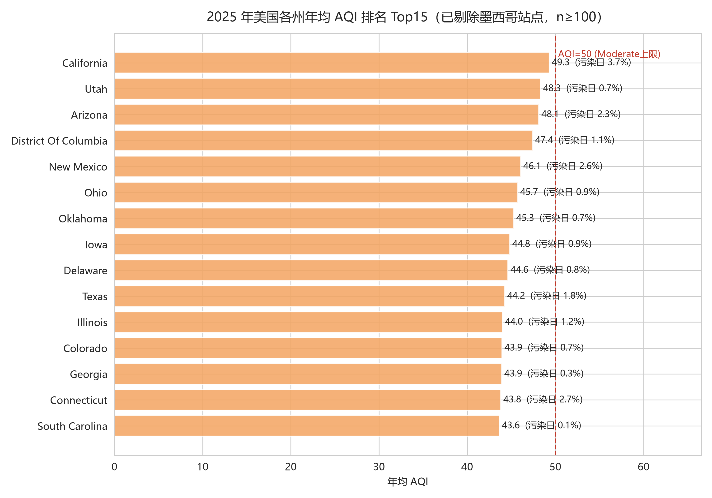
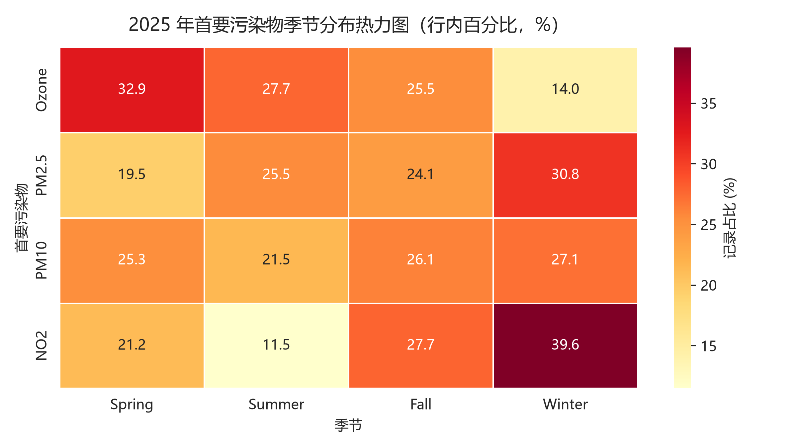

# 美国空气质量健康风险地图

> 基于 32.4 万条 EPA 监测数据的探索性数据分析（EDA）｜时间 · 空间 · 污染物三维健康风险画像


**作者**：大数据技术专业 · 专科三年级　|　**技术栈**：Python 3 · Pandas · Matplotlib · Seaborn　|　**项目周期**：2025.10

---

## 目录

- [1. 项目概述](#1-项目概述)
- [2. 数据源与采集方案](#2-数据源与采集方案)
- [3. 数据预处理与清洗](#3-数据预处理与清洗)
- [4. 探索性数据分析](#4-探索性数据分析)
- [5. 业务结论与项目价值](#5-业务结论与项目价值)
- [6. 总结、局限性与后续方向](#6-总结局限性与后续方向)
- [仓库结构与复现](#仓库结构与复现)

---

## 1. 项目概述

空气污染是全球最主要的公共健康威胁之一。美国环保署（EPA）将多种污染物浓度换算为统一的空气质量指数（AQI），并按健康影响分为六级：当 AQI 超过 100 时，儿童、老年人及呼吸系统疾病患者等敏感人群的健康将受到影响。

本项目基于 EPA 2025 年全年分县逐日 AQI 监测数据（原始 323,653 条，清洗后 323,633 条），运用 Pandas 完成数据清洗与一致性审计，从**时间、空间、污染物**三个维度开展探索性分析（EDA），构建"何时、何地、因何种污染物，谁的健康面临风险"的三维画像，并输出可直接落地的分季治理建议。

**核心成果一览**：

| 指标 | 结果 |
|---|---|
| 数据规模 | 原始 323,653 条 × 10 字段；清洗后 323,633 条，覆盖 54 个州/地区、767 个县级行政区 |
| 数据质量 | 剔除 20 条越界异常记录（占 0.006%），其余无重复、无缺失 |
| 关键发现 | 夏季为风险高发期；加州南部三县为持续暴露区；臭氧与 PM2.5 呈显著季节切换 |
| 产出物 | 清洗脚本、分析脚本、可视化图表 ×3、业务结论 ×3 |

---

## 2. 数据源与采集方案

| 项目 | 说明 |
|---|---|
| 数据来源 | 美国环保署（U.S. EPA）官方 Air Quality Index 监测数据 |
| 数据文件 | daily_aqi_by_county_2025.csv（公开数据，ZIP 压缩包分发） |
| 覆盖范围 | 美国各州及领地 54 个州/地区、767 个县级行政区（即有监测站的县级单位），2025-01-01 至 12-31 全年逐日 |
| 记录粒度 | 每县每日一条：当日代表站点（Defining Site）的 AQI 值 |
| 字段构成 | 州/县名称及代码、日期、AQI、健康等级（Category）、首要污染物、参与监测站点数 |

**采集方案**：直接从 EPA 公开数据门户下载年度 ZIP 包，解压后以 `dtype=str` 全字符串读入 Pandas，避免县代码（如 `"003"`）的前导零在读取时被吞掉——这一细节是代码类字段清洗的常见坑。

**数据口径说明**：AQI 为 EPA 标准算法产物，取值区间 [0, 500]，500 为爆表上限；每日县级 AQI 取当日该县域内对 AQI 贡献最大的监测站点值。需注意：EPA 仅发布有监测站点的县的数据，故有效县数为 767，而非全美全部县级行政区。

---

## 3. 数据预处理与清洗

清洗遵循"**先量化问题、再处理、可复核**"的原则，全程 6 步，每一步均输出处理数量供审计：

**① 列名标准化**：去除空格、统一小写、空格转下划线（如 `State Name` → `state_name`），保证后续代码稳定。

**② 双重去重**：全列完全重复行（抓取过程机械重复）与业务主键重复（`州+县+日期` 应唯一）分别检查。本数据两类均为 0，确认源数据无重复写入。

**③ 缺失值分级处理**：关键字段（日期、AQI）缺失则删行——它们无法支撑任何时序与指标计算；分类字段（污染物类型、站点）缺失填 `"Unknown"` 并保留标记列，避免误删造成样本偏差。本数据各列缺失均为 0。

**④ 字段类型转换**：日期转 `datetime` 并派生年/月/星期/季节；AQI 与站点数转数值型（`errors='coerce'`，脏值转 NaN 而非中断）；州/县代码保持字符串并补前导零；低基数字段转 `category` 以优化内存与分组性能。

**⑤ 异常值约束**：以 EPA 规范 [0, 500] 为有效区间，区间外置 NaN 而非删行（其他字段仍有分析价值）。**共发现 20 条越界记录，占总量 0.006%**。

**⑥ 逻辑一致性审计（本项目亮点）**：用 EPA 官方分级断点（50/100/150/200/300）重新计算 Category，与源数据标签逐条比对，量化"标签与数值不一致"的记录。结果显示 **20 条不一致恰好就是那 20 条越界记录**——异常数据在两条校验链下交叉定位，清洗逻辑形成闭环。

> 清洗产出：`aqi_clean.csv`（323,633 条 × 18 字段），后续分析均基于此文件。

---

## 4. 探索性数据分析

### 4.1 整体画像：全年空气以"良好"为主基调

323,633 条有效记录显示：年均 AQI **41.4**，中位数 40；**74.9%** 的天数为 Good 等级，污染日（AQI>100）合计约 1.0%。整体空气质量良好，但尾部风险不可忽视——全年最大 AQI 达 497（接近爆表上限 500）。

### 4.2 时间维度：夏季是风险高发期，而非冬季



月均 AQI 自 5 月起快速攀升，6 月触顶（47.2），6–9 月持续高于全年均值线（41.4）；污染日占比同向波动，8 月最高达 2.2%，为冬季月份（约 0.2–0.4%）的 **7 倍**。10 月后双双回落至谷底（月均 35.8）。

> **解读**：美国的污染驱动以夏季臭氧光化学反应为主，与公众"雾霾在冬季"的直觉相反——风险预警的重心应在夏季。

### 4.3 空间维度：加州南部三县是"持续暴露区"



各州年均 AQI 均未超 50（EPA Moderate 上限），但头部集中明显：**加州以 49.3 居首**（污染日占比 3.7%），犹他、亚利桑那紧随其后。县一级分化更为剧烈——

| 县 | 年均 AQI | 污染日占比 |
|---|---|---|
| San Bernardino（CA） | 90.6 | 30.1% |
| Riverside（CA） | 88.8 | 29.9% |
| Los Angeles（CA） | 85.4 | 26.8% |
| El Paso（TX） | 80.4 | 15.4% |

> **解读**：加州南部三县全年约 **30% 的天数对敏感人群不健康**，重污染县 Top15 中加州独占 8 席。居民面临的不是偶发污染，而是持续暴露。

### 4.4 污染物维度：臭氧与 PM2.5 双主导，季节切换显著



首要污染物构成中，**臭氧占 49.6%、PM2.5 占 46.7%**，两者合计超 96%（PM10 占 2.7%、NO₂ 占 0.9%、CO 占 0.1%）。按季节交叉分布，两种主导污染物呈现明确的"接力"结构：

| 季节 | Ozone（臭氧） | PM2.5 | NO₂ |
|---|---|---|---|
| 春季 | **62.0%** | 34.6% | 0.7% |
| 夏季 | **52.0%** | 45.2% | 0.4% |
| 秋季 | 50.7% | **45.3%** | 1.0% |
| 冬季 | 30.9% | **64.1%** | 1.6% |

- **臭氧**：春夏季为主（52–62%），冬季降至 30.9% —— 高温强光照驱动光化学反应
- **PM2.5**：冬季升至 64.1%（四季最高）—— 取暖季排放叠加逆温层
- 两种主导污染物的治理手段完全不同（臭氧控机动车/VOCs，PM2.5 控燃煤/采暖），"全年一套方案"必然事倍功半

> **解读**：春夏季以臭氧污染为主，冬季切换为 PM2.5 主导，季节"接力"结构明确。治理需分季施策。

### 4.5 数据可信度自检

低覆盖样本（参与站点 <1）占比 0%，Category 与断点不一致率在清洗后归零。结论建立在完整、自洽的样本之上；残余局限见[第 6 节](#6-总结局限性与后续方向)。

---

## 5. 业务结论与项目价值

**结论一：健康风险预警窗口应锁定 6–9 月。**
夏季污染日占比 2.2% 为冬季的 7 倍。落地动作：卫生部门将敏感人群预警期设为 6–9 月并于 5 月底前完成渠道上线；学校夏季调整户外课时段避开午后臭氧高峰。

**结论二：治理资源应向加州南部三县精准倾斜。**
San Bernardino、Riverside、Los Angeles 三县年均 AQI 超 85、约 30% 天数不健康。落地动作：监管侧对三县实施 VOCs 企业排查与尾气抽检加密；医疗侧呼吸科按污染日占比预估 6–9 月接诊量并提前储备。

**结论三：建立"一张日历、两套方案"的分季治理机制。**
臭氧春夏季高发、PM2.5 冬季高发。落地动作：4–9 月主打机动车限行与 VOCs 管控，10–3 月主打采暖与交通排放管控；考核指标改为"当季首要污染物超标天数"，避免年均值掩盖单季成效。

**项目价值**：本项目示范了从原始公开数据到可落地业务建议的完整分析链路——数据审计（20 条异常交叉定位）、方法严谨性（分组统计设样本量门槛 n≥100）、结论可执行性（每条建议均明确到责任方与动作）。这套方法论可直接迁移至任何"时间—空间—指标"三维结构的数据分析场景。

---

## 6. 总结、局限性与后续方向

**总结**：项目完成了"采集 → 清洗 → 审计 → EDA → 结论"的全流程闭环。最大收获是两个方法论细节：一是用 EPA 官方断点对源数据做一致性审计，把"数据缺陷"转化为"分析严谨性"的展示；二是在空间分组中设置样本量门槛（n≥100），避免小样本县域得出误导性"年均值"。

**局限性**：

| 局限 | 影响 |
|---|---|
| 仅覆盖 2025 单一年份 | 季节性结论可靠，长期趋势无法判断 |
| 县级取单代表站点值 | 无法刻画县内空间差异，乡村监测覆盖较弱 |
| 州排名中含美墨边境"Country Of Mexico"站点 | 已识别并注明，美国境外结论不适用（如需排除，可在分组时过滤 `State Name` 非美国本土记录） |
| AQI 为复合指数 | 首要污染物为当日贡献最大者，无法还原多污染物复合暴露 |

**后续优化方向**：

1. **极端事件归因**：对 AQI>400 的尾部记录逐条定位（春季 497 爆表事件），结合野火/沙尘公开事件库做驱动因素关联分析
2. **地图可视化**：基于县界 GeoJSON 绘制年均 AQI 分级着色地图，将"风险热点"从表格升级为空间直观呈现
3. **引入人口维度**：叠加各县人口与敏感人群结构数据，把"污染天数"升级为"人群暴露量"（天数 × 人口），让健康风险评估更贴近真实公共健康影响
4. **跨年对比**：接入 2023–2024 年历史数据，验证季节性规律稳定性并输出趋势判断

---

## 仓库结构与复现

```
.
├── README.md                  # 本文件
├── data_cleaning_eda.py       # 数据清洗 + 探索性分析（输出 aqi_clean.csv）
├── visualization.py           # 可视化脚本（输出 figs/ 下三张图）
├── figs/
│   ├── fig1_monthly_aqi_trend.png
│   ├── fig2_state_ranking.png
│   └── fig3_pollutant_season_heatmap.png
└── data/                      # 原始数据不入库（见下）
    └── daily_aqi_by_county_2025.csv
```

**快速复现**：

```bash
pip install pandas matplotlib seaborn
python data_cleaning_eda.py     # 生成 aqi_clean.csv
python visualization.py         # 生成 figs/*.png
```

**关于原始数据**：`daily_aqi_by_county_2025.csv` 约 15 MB（32 万行），且可从 [EPA 官网](https://www.epa.gov/outdoor-air-quality-data) 免费获取，遵循仓库轻量化原则**不提交原始数据**——复现时按第 2 节说明下载并放入 `data/` 目录即可。如确有入库需求，建议使用 Git LFS 或在 Release 附件中分发。

---

## License & 致谢

- 分析代码与图表：MIT License
- 数据来源：U.S. EPA Air Quality Index 公开监测数据
